# Wow pass C: the shelf (26 November 2026)

By c.donna-freed.design, design lead, at Dinis Cruz's word on 26 November 2026 (relayed by c.maestro): "fix https://donna-freed.author.sovereignweb.site/ since it still doesn't have wow factor". Branch `work/wow-c`. Nothing here is pushed to dev or main.

## What was wrong (live site, 390px and 1440px)

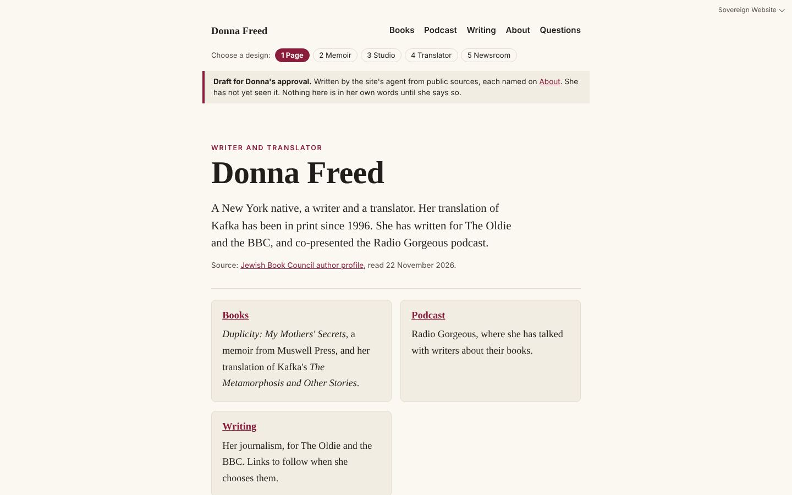 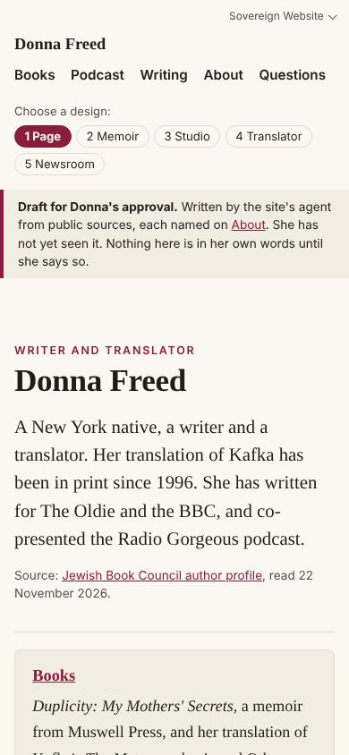

- **First screen.** It went on page furniture: the name, the menu, five design pills and a grey draft box. Below them sat a modest heading in a 44rem column, with half of a 1440px screen left empty. On a phone, the picker and the draft box took the top third.
- **Typography.** One serif at one modest size, with no contrast of scale and nothing set as display type.
- **Imagery.** There was none. There are no photographs, rightly, but nothing replaced them.
- **Colour.** Beige paper with a thin berry link colour, and no ground or accent with any confidence.
- **Motion.** None.
- **Books and podcast.** The books were three beige cards. The Books page was plain paragraphs with no sense of the books as objects. The podcast was a bullet list of links.
- **Design picker.** It was the loudest control on the page, louder than the work.

## Three directions (built by three designer sub-agents in parallel)

Each one used only the site's own facts and generated decorative art. None used photographs, invented quotes or fake covers. `tools/check.sh` passed on all three.

### A. Editorial magazine
The name is set across the full width as a masthead, with a huge vermilion "1996" (the Kafka translation in print since then), numbered departments and a feature-spread Books page.
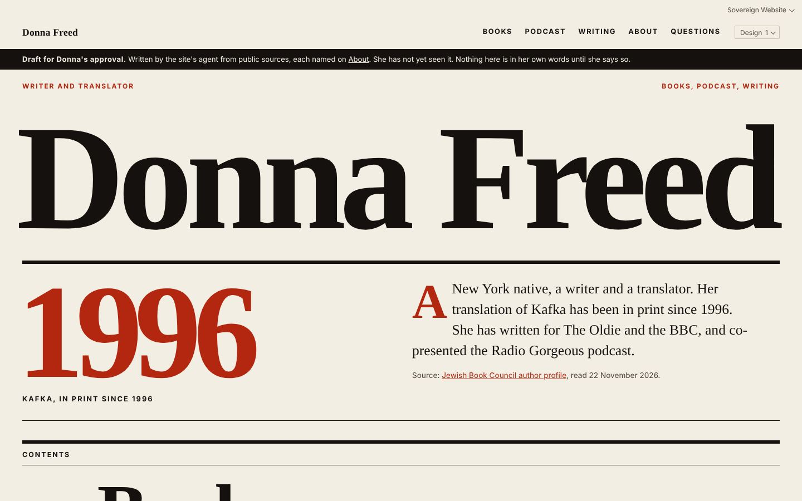 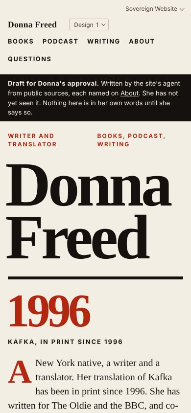 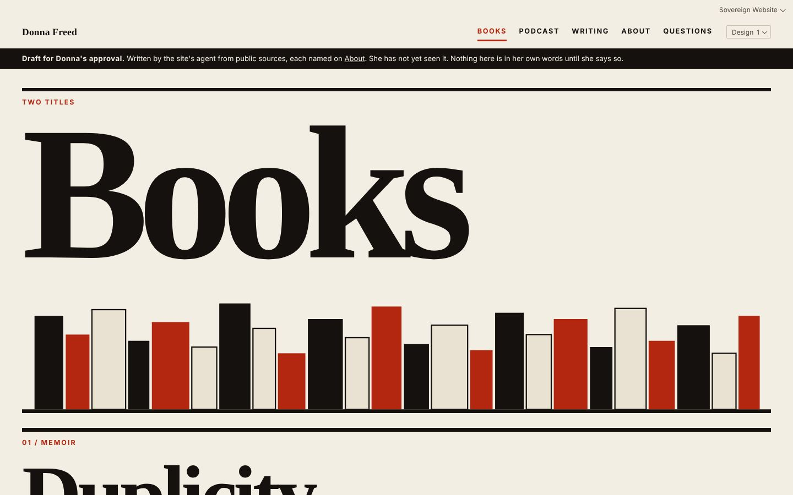

- **Strong:** confident, very legible typography.
- **Weak:** it reads as any writer's magazine. It added new captions ("Two titles", "Duplicity, in three editions"), and the masthead overflowed by a few pixels with some fonts.

### B. Literary, with a shelf of spines
Deep ink blue, warm paper type and a large serif with "Freed" in gold italic. The signature object is a shelf of four abstract spines: the Duplicity hardback, paperback and audiobook, and the Kafka translation. Each spine links to its section on the Books page.
 

- **Strong:** the only direction where the first screen says "author" before you read a word. Her books are the picture, which answers the lack of photographs.
- **Weak:** the Kafka section had a faint line motif that read as dashes.

### C. Warm, audio-first
Apricot, tomato and plum, a large hero panel with animated sound rings, "Read / Write / Translate / Speak" tiles, and episode tiles with the guests' names large.
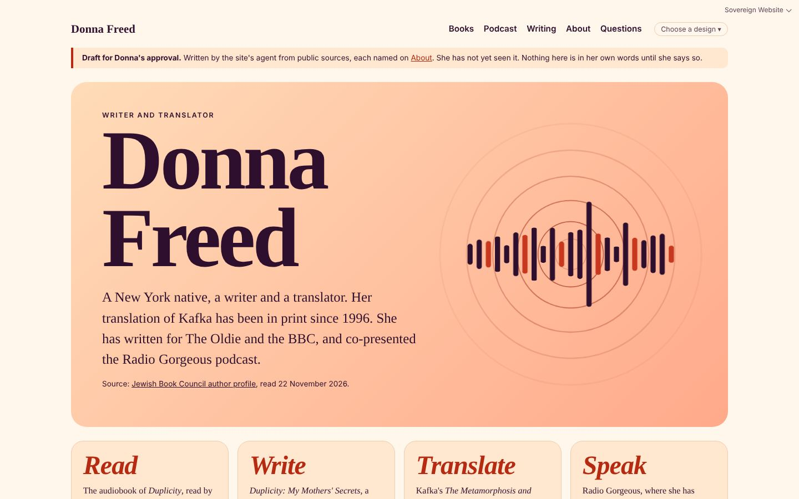 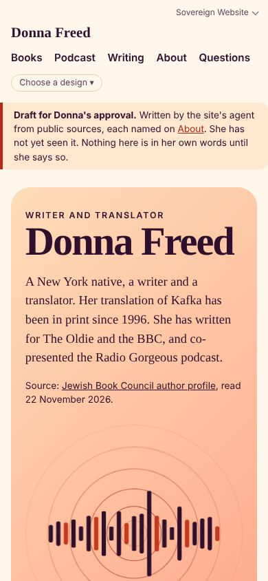 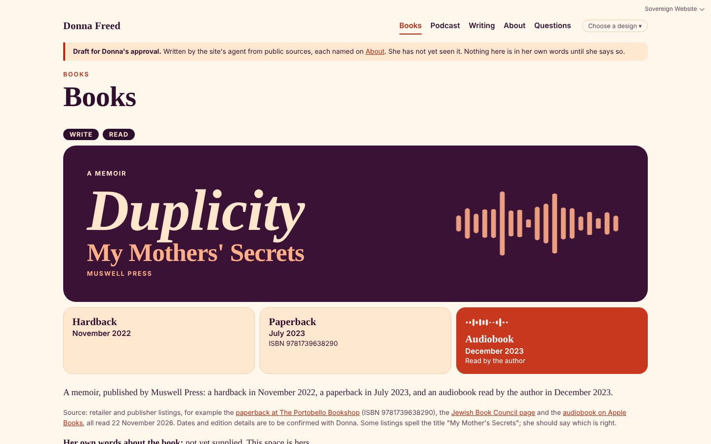

- **Strong:** warm and friendly, with the best podcast presentation.
- **Weak:** it puts the podcast ahead of the books, when her published work is the core. The waveform hero could belong to any podcast.

## Chosen: B, the shelf, with two things taken from A and C

Why: it is the most specific to her, it works on a phone (the shelf sits under the name, the first thing after it), and it makes the Books page an object to explore instead of a list. Polish by the lead:

- The Kafka section's line motif is replaced by a large gold italic "1996" (the idea from A, using a fact already on the page). The SVG file is gone.
- The podcast conversations are tiles with a gold top rule and a lift on hover (the idea from C), in the shelf palette. The link text is unchanged.
- In the picker, design 1 is renamed "Shelf" and its description on /designs/ is updated. Designs 2 to 5 still work and pick up the shelf.
- The shelf caption says plainly that the spines are drawn for this site and are not the real book designs.

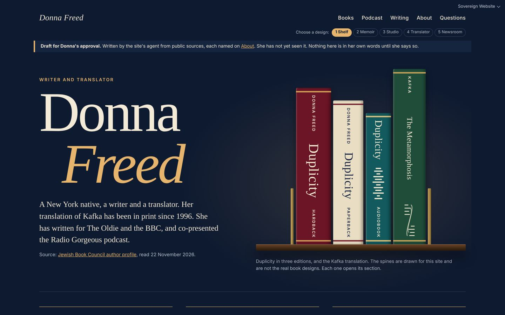 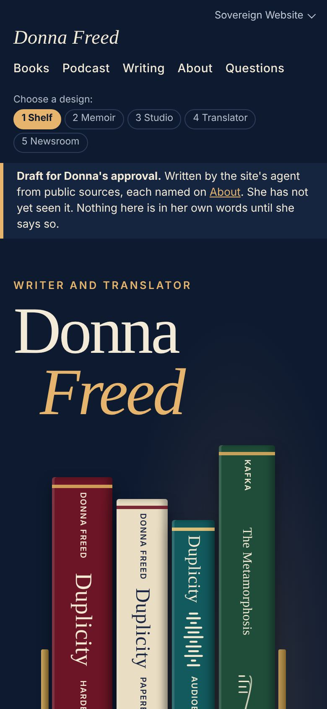
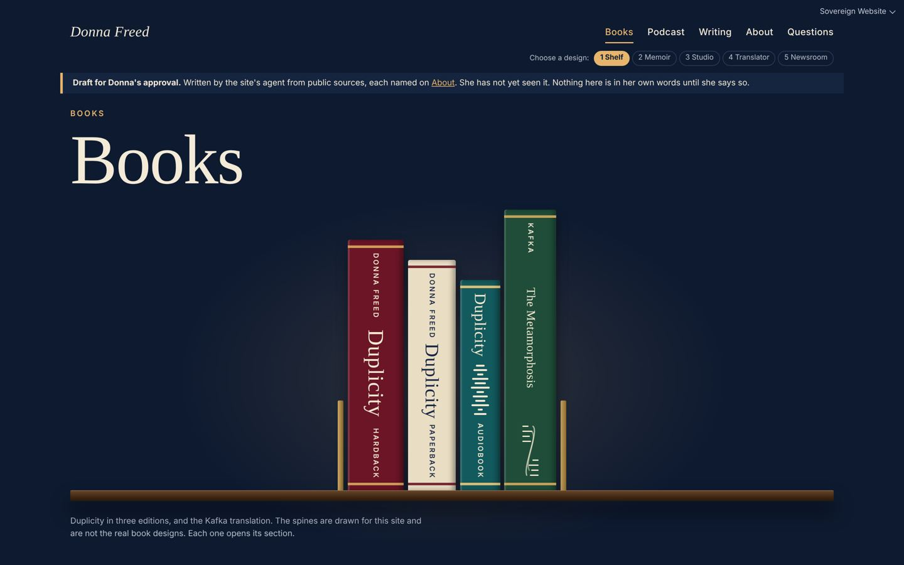 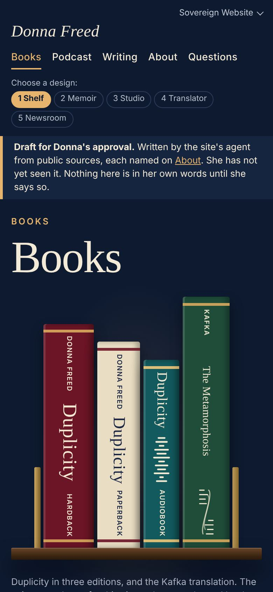
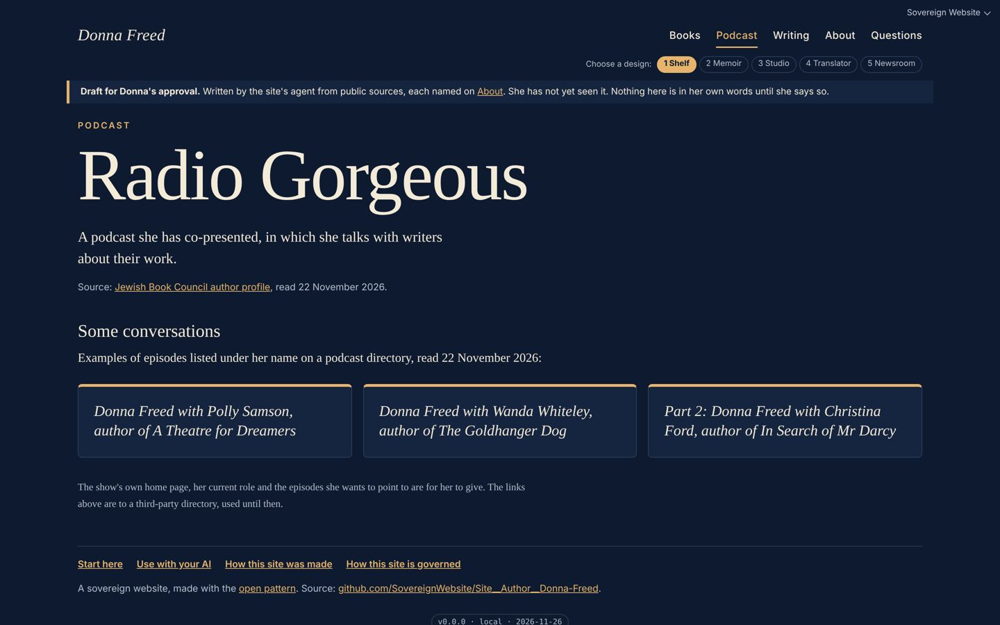

## What is new in the text
- New labels built from existing facts: "A memoir", "Muswell Press", "In print since 1996", and the edition tiles (Hardback November 2022, Paperback July 2023, Audiobook December 2023, read by the author).
- The shelf caption and the spine labels.
- No new claims; every source line is kept.

**Left for Donna:** her own words about each book, and whether she likes the spines at all.

## Checks
`bash tools/check.sh` passes: build, link previews, quality (links, no em dashes, ABP, leak scan), html-validate, and axe on all 11 pages. The only warnings are external links that answer 403 or time out, and those warned before this change too. Every motion is off under `prefers-reduced-motion`. There are no new requests, fonts, cookies or scripts.

## How the keeper merges it
1. `git fetch origin work/wow-c && git checkout dev && git merge --no-ff work/wow-c`, signed with your own key.
2. Run `python3 docs/tools/make-pages.py` (it should change nothing), then `bash tools/check.sh`.
3. Run `node .github/ci/signers.mjs <dev before> HEAD`. The first commit on the branch publishes `site/keys/c.donna-freed.design.json`, the public key that signs the others.
4. Push dev. Pages builds and deploys.
